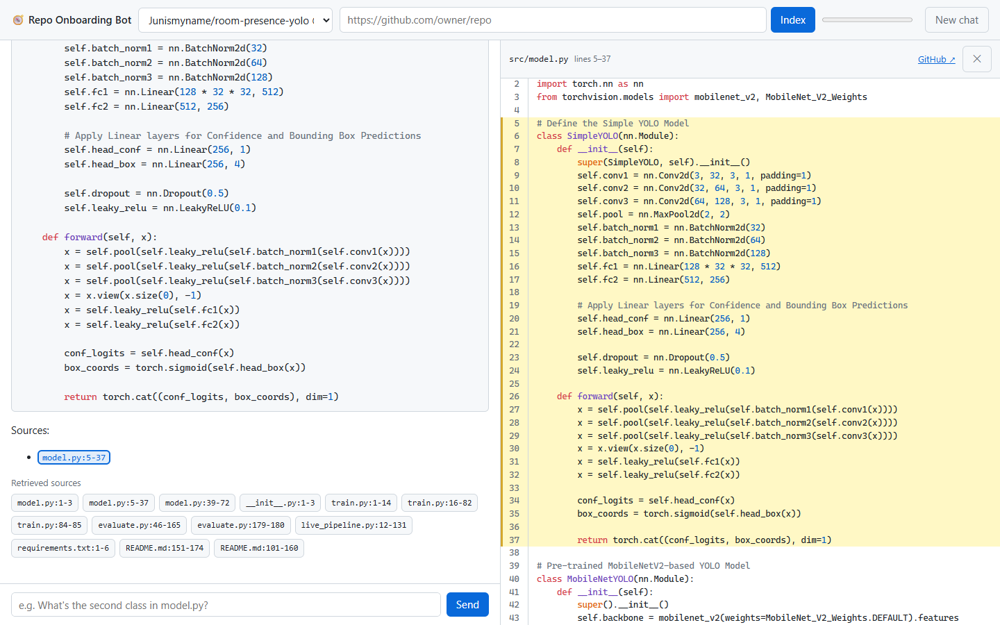

# 🧭 Repo Onboarding Bot

Paste a GitHub URL, then ask questions about the codebase, including follow-ups. Every
citation in an answer is clickable and opens the cited lines in a side panel. Fully
self-hosted: the LLM, embedding model and vector DB all run on one consumer GPU
(RTX 5070, 12 GB), with the LLM served by vLLM.



Every design choice below was measured, not assumed. Several of my assumptions turned out
wrong (see [What the measurements changed](#what-the-measurements-changed)).

## Architecture

```
GitHub URL ──► ingestion job (background, one at a time)
                 shallow clone (optionally pinned to a commit) → filter files
                 → chunks: tree-sitter for code (function/class/method), heading sections for markdown
                 → repo map (README + file list + top-level symbols)
                 → dense embeddings (gte-modernbert-base, GPU fp16) + BM25 sparse
                 → Qdrant (one collection per repo@commit)

Question (+ earlier turns) ──► FastAPI /ask
                 follow-up? → LLM rewrites it into a standalone question
                 file named in the question? → its outline + its chunks
                 dense search over code (top 10) + dense search over docs (top 3)
                 → prompt: repo map + code in file order + outline + recent turns + citation rules
                 → vLLM (Qwen2.5-Coder-7B-Instruct-AWQ)
                 → streamed answer (SSE) with [path:lines] citations

Web UI (/ui, plain JS served by FastAPI)
                 citations → source viewer: whole file, cited lines highlighted
```

## Results

All numbers: RTX 5070 12 GB, vLLM 0.32.0, Qwen2.5-Coder-7B-Instruct-AWQ, Windows 11 + WSL2 Docker.
Eval set: 46 hand-written questions over 3 repos ([psf/requests](https://github.com/psf/requests),
[pallets/click](https://github.com/pallets/click), [axios/axios](https://github.com/axios/axios)),
each labeled with the file(s) that implement the answer, checked against the source.
Questions use newcomer phrasing, not function names. All evals run against the commits pinned
in `eval/repos.json`.

### Final test (2026-10-22, current code, every eval)

| Eval | Result |
|---|---|
| Retrieval, code scope, dense (46 questions) | R@1 0.65 · R@5 0.83 · R@10 0.88 · MRR 0.75 · 31 ms p50 |
| Answers with a citation | 100% (2 runs) |
| Answers citing an expected file | 70% / 65% (all recent configs: 61–78% across runs) |
| Citations matching a sent source | 83% / 88% |
| How-to: all documented commands present (12 questions) | 12/12, 12/12 |
| File-structure ("second class in X", 46) | 85% |
| Follow-ups (15 two-turn conversations) | 15/15 |
| Single user, end to end | first token 1.1 s p50 · full answer 3.6 s p50 |
| 16 concurrent users | 0.88 req/s · 0 failures · first token 3.1 s p50 |
| First question after server start | sources in 0.17 s (was 23–35 s before startup warm-up) |
| Errors during all runs | 0 LLM stream errors · 0 prompts over the token budget |

### Retrieval ablations (`eval/run_eval.py`)

File-level recall@k = share of expected files in the top-k distinct retrieved files.

| Chunking | Scope | Search | R@1 | R@5 | R@10 | MRR | p50 latency |
|---|---|---|---|---|---|---|---|
| 60-line windows | all files | dense | 0.28 | 0.78 | 0.85 | 0.51 | 61 ms |
| tree-sitter | all files | dense | 0.49 | 0.82 | 0.84 | 0.62 | 62 ms |
| tree-sitter | all files | BM25 | 0.11 | 0.50 | 0.70 | 0.30 | 23 ms |
| tree-sitter | all files | hybrid (RRF) | 0.24 | 0.72 | 0.84 | 0.48 | 63 ms |
| tree-sitter | all files | hybrid + rerank | 0.21 | 0.68 | 0.76 | 0.42 | 211 ms |
| 60-line windows | code only | dense | 0.59 | 0.87 | 0.90 | 0.74 | 60 ms |
| **tree-sitter** | **code only** | **dense** ✅ | **0.65** | 0.83 | 0.88 | **0.75** | 60 ms |
| tree-sitter | code only | hybrid (RRF) | 0.55 | 0.85 | 0.86 | 0.72 | 61 ms |
| tree-sitter | code only | dense + bge-reranker-base | 0.50 | 0.85 | 0.92 | 0.67 | 173 ms |
| tree-sitter | code only | dense + bge-reranker-v2-m3 | 0.54 | 0.89 | 0.93 | 0.70 | 316 ms, +1.5 GiB VRAM |

With 46 questions, one question ≈ 0.02, so gaps under ~0.05 are noise.

What this shows:
- **Prose crowds out code.** The questions are plain English, so in a mixed search, docs and
  changelogs win. With all files in scope, the re-ranker put a docs/markdown file at rank 1 for
  30 of 46 questions. Searching code separately was the biggest single gain (R@1 0.49 → 0.65).
  Docs still reach the LLM through their own small budget (3 chunks).
- **BM25 is weak for newcomer questions.** People don't know the identifiers yet, and
  hybrid fusion pulled dense results down.
- **The re-rankers trade top-1 precision for deeper recall.** They're general text models, not
  code models, and the gain at R@10 is within noise. Off by default; `REPOBOT_USE_RERANKER=true`
  turns it on.
- **Tree-sitter mostly helps when docs aren't filtered out.** In code-only search, line windows are
  close (0.59 vs 0.65). It stays because chunks carry symbol names (`Session.request`), which
  feed the repo map and citations, and chunks are smaller (median 13 vs 60 lines).

### Answer quality (`eval/run_answer_eval.py`, end to end through the API)

| Prompt / server config | Answers with a citation | Answers citing an expected file | Citations that are real |
|---|---|---|---|
| Inline citation rule (run 1 / run 2) | 67% / 65% | 52% / 50% | 95% / 92% |
| + "Finish with a `Sources:` line" ✅ (run 1 / run 2) | **100% / 100%** | **70% / 70%** | 95% / 95% |
| Short snippet ids `[S3]` instead of paths | 83% | 54% | 100% |
| Inline rule + an example answer in the prompt (5 questions) | 80% | — | 44% |
| Inline rule, **fp8 KV cache** (run 1 / run 2) | 46% / 48% | 28% / 35% | 82% / 74% |
| `Sources:` line + code in file order + outlines ✅ current | 100% | 78% | 91% |

"Real" = the cited `path:lines` matches a chunk the API actually sent. Anything else was made up.
- The example answer taught the model to copy the example's fake paths.
- fp8 KV cache costs instruction-following. The drop held across two runs, while two fp16 runs
  agreed within 3 points.

### How-to questions (`eval/run_howto_eval.py`)

"How do I run this repository?" A user got one cited sentence per step ("Install the
dependencies [README.md:101-160]") and no commands. 12 questions over 4 repos, scored on
whether the answer contains the exact commands from the repo's docs or build files.

| Version | All commands present (per run) |
|---|---|
| Before | 7/10, 7/10, 8/10 |
| + markdown chunked by heading sections | 7/10, 8/10 |
| + how-to instruction for command questions | 10/10 in all 5 runs |
| + 2 questions answered only by build files (`Makefile`, `package.json`) | 11/12, 11/12 |
| + root build files searched for command questions ✅ | **12/12, 12/12** |

- **Build files.** "How do I run the test suite of requests?" filled the context with
  `tests/*.py` (code *about* testing). The `Makefile`'s `test:` target never reached the
  prompt, and the model guessed `pytest`. `Makefile`, `package.json` and `Dockerfile` are now
  indexed. For command questions, the best chunks of the root-level ones are always included.
  Nested ones are skipped: axios has 7 `package.json` files, mostly test fixtures.

- **Retrieval wasn't the problem.** The README's whole Getting Started section was in the prompt.
  The system prompt said "be concise, short snippets only", and the model followed it.
- **Markdown chunking:** heading sections replaced 60-line windows (`#` lines inside code fences
  are shell comments, not headings). "Getting Started" is now one chunk instead of being split
  across `101-160` and `151-174`. It barely moved this eval, but it keeps the steps together.
- **A rule for every question had side effects.** In the prompt for every question, it made
  answers to "how does X work?" cite docs instead of code (answers citing an expected file
  61–67%). It's now added only when the (rewritten) question mentions install / set up / run /
  build / train / test / launch: 9 of 10 how-to questions and 3 of the 46 explanation questions.
- **With the rule limited that way, nothing else measurably regressed.** Answers citing an
  expected file: 72% / 70% (the old setup's runs: 70%, 70%, 78%), structure 85%, follow-ups 15/15.
  The example in the instruction is a placeholder (`<command exactly as written in the docs>`),
  never a real command. It was copied into 0 of 102 answers.

### Questions about file structure (`eval/run_structure_eval.py`)

"What's the second class in model.py?" Semantic search can't answer this alone. A user reported
the bot named the same class as both first and second. 46 ordinal questions are generated from
the index (seed 7, 5 repos). Ground truth comes from tree-sitter line ranges, so it's exact.

| Version | Accuracy |
|---|---|
| Chunks in relevance order (before) | 33% |
| + file outline (numbered classes/functions in line order) at the top of the prompt, code in file order | 76% |
| + outline moved right before the question ✅ | **87%** |

- **The cause wasn't retrieval.** Both classes were retrieved, but chunks were listed by relevance
  (`model.py:39-72` before `model.py:5-37`), and the model counted in prompt order.
- **Placement matters again.** It's the same lesson as the citation rule: a 7B model uses
  instructions and facts near the end of a ~6k-token prompt much more reliably.
- My first scorer marked "the third function in `formDataToJSON.js` is `arrayToObject`" wrong
  because it matched `formDataToJSON` inside the file name. Fixed and re-scored.

### Follow-up questions (`eval/run_followup_eval.py`)

15 two-turn conversations, where the follow-up only makes sense with history: "What about the
first one?", "Where is that adapter class defined?". Scored on the right definition (structural)
or the right file among sources (topical).

| Version | Correct |
|---|---|
| Follow-up sent alone (before) | 8 / 15 (53%) |
| History + LLM rewrite of the follow-up before retrieval ✅ | **15 / 15** |

- Example rewrite: "Which class does that?" became "Which class does the `TimestampSigner.sign`
  method belong to?".
- **Cost:** time to first token goes from 1.19 s to 1.83 s p50 on follow-ups (one ~80-token
  rewrite call). The first turn of a chat skips the rewrite.
- Earlier turns are sent as plain question/answer text (last 3 pairs, answers trimmed). Their
  retrieved code isn't re-sent, so the prompt doesn't grow with every turn.
- 15 conversations is a small set; read 15/15 as "works on these cases," not as a 100% rate.

### Serving under load (`benchmarks/sweep.py`, Locust, 90 s per level)

Workload: random questions from the 46-question eval set across all three repos. Each prompt is
~6k tokens (repo map + 13 chunks). Users wait 1–3 s between questions. Measured before the
outline and multi-turn features. Those only change prompts for questions that name a file or
have history, which this workload doesn't.

**fp16 KV cache (default): 48k tokens**

| Users | Req/s | TTFT p50 | TTFT p95 | Total p50 | Total p95 | Prefix-cache hits |
|---|---|---|---|---|---|---|
| 1 | 0.17 | 1.3 s | 3.3 s | 3.6 s | 7.5 s | 28% |
| 2 | 0.30 | 1.0 s | 3.0 s | 4.3 s | 6.5 s | 41% |
| 4 | 0.45 | 1.4 s | 6.9 s | 6.6 s | 12 s | 45% |
| 8 | 0.51 | 3.6 s | 11 s | 14 s | 19 s | 39% |
| 16 | 0.57 | 11 s | 17 s | 21 s | 39 s | 41% |

**fp8 KV cache: 82k tokens**

| Users | Req/s | TTFT p50 | TTFT p95 | Total p50 | Total p95 | Prefix-cache hits |
|---|---|---|---|---|---|---|
| 1 | 0.22 | 1.3 s | 5.2 s | 2.1 s | 5.5 s | 41% |
| 2 | 0.33 | 1.2 s | 3.3 s | 3.7 s | 11 s | 59% |
| 4 | 0.59 | 1.8 s | 5.1 s | 4.0 s | 8.8 s | 50% |
| 8 | 0.72 | 2.2 s | 7.9 s | 7.4 s | 23 s | 54% |
| 16 | 0.90 | 3.2 s | 15 s | 11 s | 28 s | 55% |

- **The bottleneck is KV cache memory.**
  - 48k tokens ÷ ~6.5k per request ≈ 7 requests in flight.
  - Past 4–8 users, vLLM's scheduler log shows requests waiting while KV cache usage is 85–90%.
  - Throughput flattens at ~0.5 req/s and latency climbs.
- **fp8 raises throughput 58% at 16 users and cuts TTFT p50 from 11 s to 3.2 s,** but it costs answer
  quality (table above). The default stays fp16. fp8 is a one-flag option
  (`VLLM_EXTRA_ARGS=--kv-cache-dtype fp8`) for when throughput matters more.
- **A first version of this benchmark was wrong.** It cycled 5 questions, so vLLM served 97% of prompt
  tokens from its prefix cache, and TTFT p50 looked like 0.25 s. The fixed workload uses all 46
  questions, and the hit rate column above is scraped from vLLM's `/metrics` for each run.

**fp16 KV cache, final code (2026-10-22)**

| Users | Req/s | TTFT p50 | TTFT p95 | Total p50 | Total p95 | Prefix-cache hits |
|---|---|---|---|---|---|---|
| 1 | 0.16 | 1.1 s | 1.9 s | 3.5 s | 10 s | 47% |
| 2 | 0.33 | 0.91 s | 2.3 s | 3.9 s | 9.1 s | 54% |
| 4 | 0.56 | 1.1 s | 2.7 s | 4.5 s | 8.6 s | 51% |
| 8 | 0.59 | 2.9 s | 7.8 s | 10 s | 24 s | 43% |
| 16 | 0.88 | 3.1 s | 12 s | 14 s | 29 s | 57% |

Same workload and vLLM settings as the first fp16 table, but 16-user throughput went from 0.57
to 0.88 req/s and TTFT p50 from 11 s to 3.1 s. That's close to the fp8 numbers above. I haven't
isolated the cause. Two changes landed in between:
- A Qdrant call that blocked the async `/ask` handler, and so every other request, now runs in a
  thread.
- Prefix-cache hits are higher (43–57% vs 28–45%).

So the fp8 comparison (measured against the old API) likely overstates fp8's benefit. Re-running
the fp8 sweep on the current code is the next measurement to make.

### Single-request latency breakdown (warm)

| Stage | Time |
|---|---|
| Query embedding (GPU) | 23 ms p50 |
| 2 filtered Qdrant searches (code + docs) | 22 ms p50 |
| Re-ranking 50 candidates on **CPU** | 15.4 s ❌ (my original config) |
| Re-ranking 50 candidates on GPU fp16 | 160 ms (now optional, off by default) |
| Server-side `/ask` before the first byte (logged per request) | ~50 ms |
| TTFT on a 4–7k-token RAG prompt | 0.75–2.7 s (depends on prompt length and prefix-cache hits) |
| Decode speed on a 4–7k-token RAG prompt | ~97 tok/s (108 tok/s on a short prompt) |
| Full answer (p50 over the 46-question eval, 1 user) | **3.6 s** for a median 218-token answer |

That last number was 5.8 s at first. The server logged ~50 ms per request, but clients saw
sources ~2 s later. The cause: on Windows, `localhost` resolves to IPv6 `::1` first, uvicorn only
listens on IPv4, and Windows retries the refused connection for ~2 s before falling back. Every
new connection to `localhost:8080` paid 2,030 ms vs 7–29 ms for `127.0.0.1`. Docker-published
ports (vLLM, Qdrant) listen on both, so only the API was hit. Client defaults now use
`127.0.0.1`. The load test reuses connections per user, so the sweep tables are unaffected.

### GPU memory budget (12 GB card, measured)

| Consumer | VRAM |
|---|---|
| vLLM total (`gpu-memory-utilization 0.80`) | ~9.6 GiB |
|  ↳ model weights (AWQ 4-bit) | 5.29 GiB |
|  ↳ CUDA graphs | 0.28 GiB |
|  ↳ activations / overhead | ~1.4 GiB |
|  ↳ KV cache | 2.57 GiB = 48k tokens at fp16 (~56 KB/token) |
| API process: embedder (fp16) + CUDA context | ~0.7 GiB |
| Windows desktop | ~0.5–0.8 GiB |
| **Total in use / headroom** | ~10.5 / ~1.7 GiB |

At `gpu-memory-utilization 0.65`, vLLM refused to start: 0.78 GiB was left for the KV cache,
below the 0.88 GiB needed for one 16k-token request.

### Ingestion

| Repo | Chunks | Total (clone + chunk + embed + index) | Embed + index |
|---|---|---|---|
| pallets/itsdangerous | 155 | 4.8 s | 3.8 s |
| psf/requests | 808 | 9.0 s | 7.7 s |
| pallets/click | 1,584 | 12.2 s | 10.8 s |
| axios/axios | 1,853 | 18.8 s (36.2 s before the batching fix) | 16.4 s |

The clone is a one-time network cost (repos are reused per commit). Dense embedding dominates
the rest: tree-sitter chunking takes 0.4 s for axios, and BM25 runs at 3,600 chunks/s.
Code is token-dense (median chunk 387 tokens), so embedding is slower than for prose. Sending
512 chunks per `encode()` call lets sentence-transformers length-sort before batching, which cuts
padding and made ingestion 1.9× faster.

## What the measurements changed

| I assumed | Measured | Change |
|---|---|---|
| `gpu-memory-utilization 0.65` leaves room for everything | vLLM won't start: KV cache 0.78 < 0.88 GiB | 0.80 |
| CPU re-ranking takes "a few hundred ms" | 15.4 s (≈14 TFLOPs for 50×512 tokens) | GPU fp16 (160 ms), then off by default |
| Hybrid search + re-ranker beats dense | Both lower R@1; prose crowds out code | Dense, code and docs searched separately |
| jina-embeddings-v2-base-code | Its custom model code breaks on current `transformers` | gte-modernbert-base |
| Prompt wording fixes missing citations | 67% cited; an example answer caused made-up paths | Closing `Sources:` line → 100% |
| fp8 KV cache is a free 2× | +58% throughput, but citing an expected file fell 52% → ~30% | Opt-in only |
| 5 benchmark questions are enough | 97% prefix-cache hits made TTFT look 5× better | 46-question workload + hit-rate column |
| End-to-end latency is model time | 2 s of every 5.8 s answer was Windows trying IPv6 for `localhost` | Clients use `127.0.0.1`; per-request stage logs |
| A missing command means retrieval missed it | The whole Getting Started section was in the prompt; "be concise" made the model summarize it | Command-only how-to instruction: 7/10 → 10/10 |
| Two runs of the same eval are within ~3 points | Same config: 70%, 70%, 78% | Compare ranges over repeated runs, not single numbers |
| Re-cloning a repo gives the same code | axios got new commits, so a re-index silently changed the eval's ground truth | Ingestion can pin a commit; `eval/repos.json` lists the eval commits |
| Wrong ordinal answers mean bad retrieval | Right chunks retrieved, but shown in relevance order | Code in file order + outline next to the question: 33% → 87% |
| The LLM server either works or is down | After 6 h, `CUDA error: unknown error` killed vLLM's engine while its HTTP server (and container status) stayed "up", and answers cut off mid-stream | Docker healthcheck on `/health`, `restart: unless-stopped`, API sends an `error` event instead of a broken stream |

### Found in code review

| Problem | Fix |
|---|---|
| Prompt size unbounded: up to 8 named-file + 10 code + 3 docs chunks, the repo map and history; max seen 10.3k of 16.4k tokens | Token budget with the real tokenizer and chat template drops the lowest-scoring chunks; limit read from vLLM's `/v1/models` at startup |
| A repo was queryable while still indexing, and an ingestion killed midway looked complete forever | Repo map written last marks an index complete; leftovers are rebuilt |
| Models loaded on the first request (23–35 s), and two first requests could load them twice | Loaded and warmed up at startup, behind a lock |
| Eval pins were 12-char short SHAs, which GitHub can't fetch, so the evals weren't reproducible elsewhere | Full SHAs; every eval and the load test resolve repos through `eval/pins.py` |
| README sections inside the prompt's ``` fences closed them early | Outer fence is longer than any backtick run in the chunk |
| History could start with an answer; earlier questions weren't length-capped | Trimmed to start with a question; all turns capped |
| Switching repo mid-answer orphaned the streaming message | Repo picker and "New chat" disabled while answering |
| `transformers` used but not declared | Declared (`>=4.48` for ModernBERT) |
| API container could start before the model was loaded | `depends_on: condition: service_healthy` |
| Load test crashed on the follow-up file, and the sweep script hid the error | Workload filter fixed; sweep prints Locust's error |

## Layout

```
src/repobot/
  config.py            settings (env vars prefixed REPOBOT_)
  models.py            Chunk, RepoRef, ScoredChunk
  services.py          shared models/clients (built once)
  metrics.py           recall@k, MRR
  ingestion/           clone → filters → chunker (tree-sitter) → repo_map → pipeline
  indexing/            embedder (dense + BM25), store (Qdrant, scoped search)
  retrieval/           code + docs retrieval, file outlines, optional re-ranker
  generation/          prompts, follow-up rewriting, streaming LLM client
  api/                 FastAPI app, job tracking, schemas
  web/                 UI: chat, clickable citations, source viewer (no build step)
eval/                  golden questions; retrieval, answer, structure, follow-up evals; results/
benchmarks/            Locust load test + concurrency sweep
scripts/smoke_llm.py   check the LLM server, measure TTFT and tok/s
docker-compose.yml     vLLM + Qdrant (+ API with --profile app)
```

## Quickstart

Requires WSL2 + Docker Desktop with GPU support, and Python 3.12–3.13.

Windows (Anaconda Prompt / cmd):

```bat
copy .env.example .env
conda create -n repobot python=3.12 -y
conda activate repobot
pip install torch --index-url https://download.pytorch.org/whl/cu128
pip install -e ".[bench,dev]"

docker compose up -d vllm qdrant
docker compose logs -f vllm
python scripts/smoke_llm.py

uvicorn repobot.api.main:app --host 127.0.0.1 --port 8080
```

Then open http://127.0.0.1:8080/.

- Install PyTorch first: Blackwell GPUs (RTX 50xx) need the cu128 build.
- The first `docker compose up` downloads the vLLM image and the model (~5 GB). Wait for
  "Application startup complete" in the logs (3–10 min) before running the smoke test.
- Git Bash + conda: if Python fails with `FileNotFoundError` in `ssl.create_default_context`,
  conda's OpenSSL hook set a wrong `SSL_CERT_FILE`. Fix:
  `conda env config vars set -n repobot SSL_CERT_FILE=%CONDA_PREFIX%\Library\ssl\cacert.pem`.

Reproduce the results (API running, vLLM up):

```bat
python eval/run_eval.py eval/questions/requests.jsonl eval/questions/click.jsonl eval/questions/axios.jsonl
python eval/run_answer_eval.py eval/questions/requests.jsonl eval/questions/click.jsonl eval/questions/axios.jsonl
python eval/run_structure_eval.py
python eval/run_followup_eval.py
python eval/run_howto_eval.py
python benchmarks/sweep.py --tag fp16 --users 1 2 4 8 16 --duration 90
```

Fallback if vLLM won't run: start Ollama, then set `REPOBOT_LLM_BASE_URL=http://localhost:11434/v1`
and `REPOBOT_LLM_MODEL=qwen2.5-coder:7b`.

## Status

- [x] Ingestion: shallow clone, filtering, tree-sitter chunking (Python, JS, TS), repo map
- [x] Retrieval: dense + BM25 + RRF + optional re-ranker, code/docs scopes
- [x] API with background ingestion jobs and streamed answers with citations
- [x] Multi-turn chat (follow-up rewriting) and file-structure questions (outlines)
- [x] Web UI: clickable inline citations, source viewer with highlighted lines, mobile layout
- [x] Evals: retrieval (46 × 20 configs), answers, structure, follow-ups, how-to, load sweep, fp8 KV
- [x] Robustness: token budget, complete-index marker, startup warm-up, pinned eval commits
- [ ] Re-run the fp8 KV sweep on the current API (the old comparison predates the event-loop fix)
- [ ] Demo video
- [ ] API Docker image (`--profile app`), written but not yet built or tested
- [ ] Public demo via Cloudflare Tunnel
- [ ] Tracing (Langfuse / OpenTelemetry)
